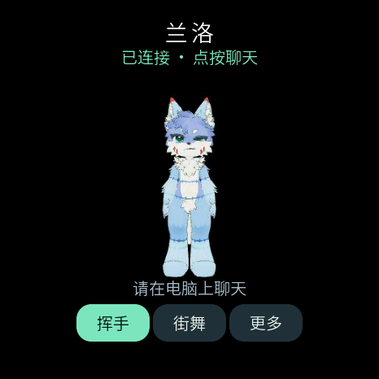
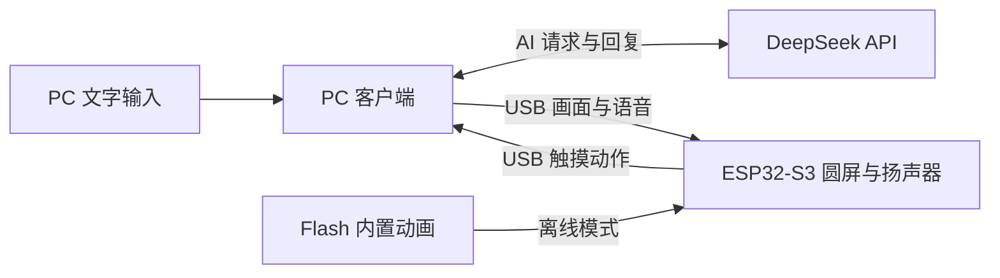

# 兰洛电子宠物 ESP32-S3

在 1.75 英寸 AMOLED 圆屏上陪伴、互动和聊天。

基于 **Waveshare ESP32-S3-Touch-AMOLED-1.75C** 与 **ESP-IDF**：开发板独立播放兰洛动画、响应触摸；连接 PC 客户端后，同步角色画面、AI 回复和中文语音。



**快速入口：** [PC 客户端项目](https://github.com/timechuchen/electronic_pet_PC) · [使用与功能说明](使用与功能说明.md) · [Windows 烧录说明](Windows烧录说明.md) · [开发说明](docs/开发说明.md)

## PC 客户端与下载

**本仓库负责 ESP32 固件与编译烧录，不再分发 PC 安装包。** Mac、Windows 桌宠的源码、安装包和使用说明统一维护在独立 PC 项目：

- **项目地址：** [electronic_pet_PC](https://github.com/timechuchen/electronic_pet_PC)
- **安装包下载：** [PC 项目 Releases](https://github.com/timechuchen/electronic_pet_PC/releases/latest)
- **使用说明：** [PC 项目 README](https://github.com/timechuchen/electronic_pet_PC#readme)

PC 客户端 **v1.3.0 起已包含 USB 自动连接、画面同步、触摸回传和板端语音**。给开发板烧录本仓库固件后，打开 PC 客户端即可联机。Mac 已完成实机验证；Windows 已提供构建包，USB 和系统语音仍待 Windows 实机验收，具体支持范围以 PC 项目说明为准。

本仓库的 `companion/` 保留为早期 Mac 联调工具，供开发和协议调试使用；日常联机请使用上述 PC 客户端。两个服务端不能同时占用开发板串口。

## 可以做什么

| 功能 | 离线陪伴 | 连接 PC 客户端（Mac 已验证） |
| --- | --- | --- |
| 中文圆屏界面、触摸按钮 | ✓ | ✓ |
| 待机、挥手、点头、跳舞等 9 组动作与表情 | 内置帧动画 | PC 实时渲染 |
| AI 文字对话、历史、情绪动作 | — | PC 输入，板上显示气泡与动作 |
| 中文回复朗读与说话口型 | — | PC 生成语音，板载扬声器播放 |
| 更换 VRM 模型、导入 FBX 和自定义动作 | 需重新制作离线素材 | 在 PC 客户端设置中操作 |
| 摄像头跟随、系统音乐响应 | — | 保留 PC 版入口，板端联机效果待验证 |

点一下角色会微笑，长按恢复默认动作；底部“更多”可切换五页按钮。约 2.5 秒收不到联机画面后自动切回离线模式，暂停状态可通过“继续”或长按角色解除。

## 工作方式



开发板不直接运行 VRM 或大语言模型。AI 聊天需要 PC 联网并配置自己的 API Key；USB 联机动画和本地语音测试不需要 Key，也不用给开发板配置 Wi-Fi。

## 快速开始

### 先从源码编译并烧录

**暂不提供预编译固件或烧录包。** 请克隆本仓库完整源码，安装并激活 **ESP-IDF v6.1.1**，再编译烧录。PC 桌宠下载包不能用于给开发板烧录。

```bash
git clone https://github.com/timechuchen/electronic_pet_ESP32_S3.git
cd electronic_pet_ESP32_S3
idf.py build
idf.py -p YOUR_SERIAL_PORT flash
```

将 `YOUR_SERIAL_PORT` 替换为实际串口，例如 Mac 的 `/dev/cu.usbmodem2101` 或 Windows 的 `COM5`。烧录前退出服务端并关闭串口监视器。

也可以在已激活 ESP-IDF 的环境中使用项目脚本：

| 平台 | 入口 | 作用 |
| --- | --- | --- |
| Mac | `编译并烧录.command` | 编译并自动寻找串口；也兼容本机 EIM v6.1.1 激活脚本 |
| Windows | `Windows编译并烧录.bat` | 编译后烧录，使用独立 Windows 构建目录 |
| Windows | `Windows烧录.bat` | 同样先编译源码，再烧录 |

Windows 环境准备和指定 COM 端口的方法见 [Windows 烧录说明](Windows烧录说明.md)。Windows 脚本已通过逻辑测试，**尚未进行 Windows 实机烧录验证**。

### 使用 PC 客户端联机

1. 从 [PC 项目 Releases](https://github.com/timechuchen/electronic_pet_PC/releases/latest) 下载对应系统的应用，并按该项目说明安装或完整解压。
2. 退出旧桌宠、旧服务端及串口监视器，使用 USB 数据线连接已烧录兰洛固件的开发板。
3. 打开客户端，等待菜单显示“开发板已连接”。可通过“查看开发板预览”和“测试开发板语音”检查联机。
4. AI 聊天、模型导入和语音设置请查看 [PC 项目使用说明](https://github.com/timechuchen/electronic_pet_PC#readme)。

### 开发调试：本仓库早期 Mac 服务端

以下仅适用于保留的 `companion/` 源码工具，其依赖和配置路径与独立 PC 客户端不同。

当前服务端适配 Mac Apple Silicon。需要 Python 3.11+、Node.js/npm、ffmpeg，以及 macOS 的 `Tingting` 中文声音。已有本项目环境的用户直接双击 `启动兰洛电子宠物.command` 即可；首次克隆按以下步骤准备：

```bash
git clone https://github.com/timechuchen/electronic_pet_ESP32_S3.git
cd electronic_pet_ESP32_S3

python3 -m venv companion/python
./companion/python/bin/python -m pip install -r companion/requirements.txt
npm --prefix companion ci
```

如果尚未安装 ffmpeg，可在已有 Homebrew 的前提下执行 `brew install ffmpeg`。当前语音桥接使用 `/opt/homebrew/bin/ffmpeg`；系统需有 `Tingting` 中文声音，可用 `say -v '?'` 检查。

连接已烧录本项目固件的开发板，然后启动：

```bash
./启动兰洛电子宠物.command
```

开发板显示“已连接 · 点按聊天”后：

- **⌘J** 打开聊天，在“连接设置”中填写 Key，保存后测试连接。
- **⌘,** 打开模型、动作和预设设置。
- 右键桌宠 → **测试开发板语音**，可以独立检查扬声器播放。
- 右键桌宠 → **查看开发板预览**，查看发送给小屏的画面。

首次使用系统音乐响应，需要安装 Xcode Command Line Tools，并运行 `./companion/python/bin/python companion/backend/native/build.py` 构建可选的 Mac 音频辅助程序。普通动画、触摸和回复朗读不需要该辅助程序。

> Key、聊天记录和导入素材保存在本机 `companion/data/`，不会包含在 Git 提交中。切换电脑后，需要重新准备环境和配置 Key。

## 硬件与性能

| 项目 | 当前配置或结果 |
| --- | --- |
| 开发板 | Waveshare ESP32-S3-Touch-AMOLED-1.75C |
| 内存 | 32 MB Flash、8 MB PSRAM |
| 屏幕 | 466 × 466 AMOLED 圆屏，支持触摸 |
| 联机角色画面 | 320 × 320 JPEG，经 USB 传输 |
| 联机帧率 | 本机实测约 9.8 帧／秒，随 Mac 负载和模型复杂度变化 |
| 离线动画 | 8 帧／秒，待机加 9 组动作与表情，资源约 3 MB |
| 语音播放 | 16 kHz、单声道、16 位 PCM |

## 当前限制

- AI 对话、实时 VRM 渲染和回复朗读依赖 PC 客户端；当前没有独立联网 AI 模式。
- 没有接入板载麦克风识别、语音唤醒、Wi-Fi 联机、OTA 或电池电量显示。
- 小屏长回复气泡显示空间有限，完整内容请在 PC 客户端聊天窗口查看。
- PC 客户端更换模型不会更新离线固件；离线素材需重新导出并烧录。
- 曾出现 USB 无响应而离线动画仍运行的情况，拔插后恢复，触发原因尚未确定。遇到时先拔插 USB，必要时按 RESET。

## 项目结构

```text
main/                    ESP-IDF 应用、中文界面和字体
assets/                  内置离线动画及字体许可
companion/               早期 Mac 联调工具（独立 PC 客户端见上方仓库）
  backend/               PC 角色渲染、动作、素材及本地服务
  shell/                 Electron、AI 聊天和 USB 桥接
  serial_worker.py        串口传输与自动重连
  tests/                 聊天、动作、素材测试
tools/                   字体生成、动画导出、实机检查及 Windows 烧录工具
docs/                    实机截图和开发说明
```

构建目录、下载的 SDK 组件、Node.js/Python 环境、本机配置、聊天记录、日志和原生编译缓存均不纳入版本管理。安装依赖后即可使用仓库内的源代码、前端资源和角色素材；不需要原 PC 项目的目录链接。

## 开发与验证

修改 Mac 前端后重新打包：

```bash
npm --prefix companion run build:web
```

修改 `main/ui_text.h` 中的中文文案后，先更新字库再编译固件：

```bash
npm ci --prefix tools/font-tool
node tools/build_fonts.cjs
idf.py build
```

字库生成使用 `managed_components/` 中的思源黑体源文件，首次运行前先通过 `idf.py reconfigure` 获取 SDK 组件。

运行不依赖开发板的测试：

```bash
npm --prefix companion test
./companion/python/bin/python -B -m unittest discover -s companion/tests -p 'test_*.py'
./companion/python/bin/python -B -m unittest discover -s tools -p 'test_windows_flash.py'
```

已通过 13 项聊天服务、20 项后端和 9 项 Windows 烧录逻辑测试。实机已验证中文界面、图像传输、动作回传、暂停、离线回退、语音及 USB 拔插重连。聊天气泡与动作联动采用合成回复验证，真实 AI 对话需自行配置 Key 后测试。

离线动画导出、USB 协议、实机截图及完整测试命令见 [开发说明](docs/开发说明.md) 和 [Windows 烧录说明](Windows烧录说明.md)。

## 代码与素材来源

PC 功能与兰洛素材沿用原 `CustomElectronicPet` 项目，第三方代码、模型与字体保留原有授权范围；本仓库未额外授予角色素材公开再分发许可。

相关许可见 [第三方组件说明](companion/backend/THIRD_PARTY_LICENSES.txt)、[跟踪组件许可](companion/backend/web/tracking/LICENSE.txt)、[音频组件许可](companion/backend/web/audio/LICENSE.txt) 和 [思源黑体许可](assets/fonts/SourceHanSansSC-LICENSE.txt)。
