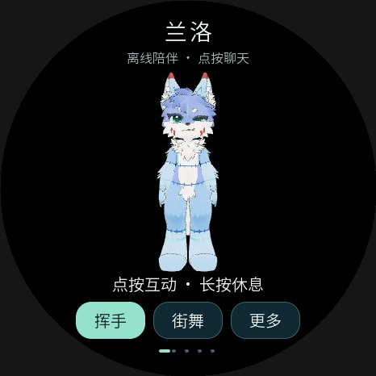
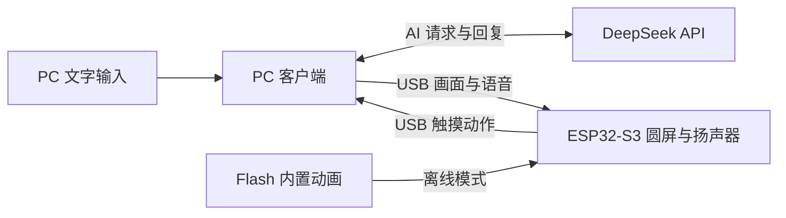

# 兰洛电子宠物 ESP32-S3

在 1.75 英寸 AMOLED 圆屏上陪伴、互动和聊天。

基于 **Waveshare ESP32-S3-Touch-AMOLED-1.75C** 与 **ESP-IDF**：开发板独立播放兰洛动画、响应触摸；连接 PC 客户端后，同步角色画面、AI 回复和中文语音。

| 默认陪伴待机 | 轻触后展开互动 |
| --- | --- |
|  |  |

以上为固件 UI 的 466×466 LVGL 软件渲染预览，实机流畅度与触摸体验仍需烧录验收。

**快速入口：** [PC 客户端项目](https://github.com/timechuchen/electronic_pet_PC) · [使用与功能说明](使用与功能说明.md) · [Windows 烧录说明](Windows烧录说明.md) · [开发说明](docs/开发说明.md)

## PC 客户端与下载

**本仓库仅维护开发板固件、离线素材和开发板工具，不包含 PC 客户端代码或安装包。** Mac、Windows 桌宠的源码、安装包和使用说明统一维护在独立 PC 项目：

- **项目地址：** [electronic_pet_PC](https://github.com/timechuchen/electronic_pet_PC)
- **安装包下载：** [PC 项目 Releases](https://github.com/timechuchen/electronic_pet_PC/releases/latest)
- **使用说明：** [PC 项目 README](https://github.com/timechuchen/electronic_pet_PC#readme)

PC 客户端 **v1.3.0 起已包含 USB 自动连接、画面同步、触摸回传和板端语音**。给开发板烧录本仓库固件后，打开 PC 客户端即可联机。Mac 已完成实机验证；Windows 已提供构建包，USB 和系统语音仍待 Windows 实机验收，具体支持范围以 PC 项目说明为准。

## 可以做什么

| 功能 | 离线陪伴 | 连接 PC 客户端（Mac 已验证） |
| --- | --- | --- |
| 中文圆屏界面、触摸按钮 | ✓ | ✓ |
| 待机、挥手、点头、跳舞等 9 组动作与表情 | 内置帧动画 | PC 实时渲染 |
| AI 文字对话、历史、情绪动作 | — | PC 输入，板上显示气泡与动作 |
| 中文回复朗读与说话口型 | — | PC 生成语音，板载扬声器播放 |
| 更换 VRM 模型、导入 FBX 和自定义动作 | 需重新制作离线素材 | 在 PC 客户端设置中操作 |
| 摄像头跟随、系统音乐响应 | — | 保留 PC 版入口，板端联机效果待验证 |

开机默认进入陪伴待机：宠物比原版约大 50%，隐藏操作菜单，离线时有轻微呼吸、眨眼、微笑和点头。轻触屏幕只唤醒菜单，再点角色才会微笑；长按空白处或角色恢复默认动作并回到陪伴待机。唤醒后底部“更多”可切换五页按钮，圆点表示当前页。20 秒未操作自动收起菜单，离线长动作会先播放完。

约 2.5 秒收不到联机画面后自动切回离线模式。显式“暂停”仍会冻结离线动画，可唤醒后切到第五页点“继续”，也可长按解除。陪伴待机是亮屏显示模式，不是芯片深度睡眠；保留触摸、USB 与音频。

## 工作方式



开发板不直接运行 VRM 或大语言模型。AI 聊天需要 PC 联网并配置自己的 API Key；USB 联机动画和本地语音测试不需要 Key，也不用给开发板配置 Wi-Fi。

## 快速开始

### 先从源码编译并烧录

**暂不提供预编译固件或烧录包。** 请克隆本仓库完整源码，安装并激活 **ESP-IDF v6.1.1**，再编译烧录。PC 桌宠下载包不能用于给开发板烧录。

```bash
git clone https://github.com/timechuchen/electronic_pet_ESP32_S3.git
cd electronic_pet_ESP32_S3
idf.py build
idf.py -p YOUR_SERIAL_PORT flash
```

将 `YOUR_SERIAL_PORT` 替换为实际串口，例如 Mac 的 `/dev/cu.usbmodem2101` 或 Windows 的 `COM5`。烧录前退出服务端并关闭串口监视器。

也可以在已激活 ESP-IDF 的环境中使用项目脚本：

| 平台 | 入口 | 作用 |
| --- | --- | --- |
| Mac | `编译并烧录.command` | 编译并自动寻找串口；也兼容本机 EIM v6.1.1 激活脚本 |
| Windows | `Windows编译并烧录.bat` | 编译后烧录，使用独立 Windows 构建目录 |
| Windows | `Windows烧录.bat` | 同样先编译源码，再烧录 |

Windows 环境准备和指定 COM 端口的方法见 [Windows 烧录说明](Windows烧录说明.md)。Windows 脚本已通过逻辑测试，**尚未进行 Windows 实机烧录验证**。

### 使用 PC 客户端联机

1. 从 [PC 项目 Releases](https://github.com/timechuchen/electronic_pet_PC/releases/latest) 下载对应系统的应用，并按该项目说明安装或完整解压。
2. 退出旧桌宠、旧服务端及串口监视器，使用 USB 数据线连接已烧录兰洛固件的开发板。
3. 打开客户端，等待菜单显示“开发板已连接”。可通过“查看开发板预览”和“测试开发板语音”检查联机。
4. AI 聊天、模型导入和语音设置请查看 [PC 项目使用说明](https://github.com/timechuchen/electronic_pet_PC#readme)。

## 硬件与性能

| 项目 | 当前配置或结果 |
| --- | --- |
| 开发板 | Waveshare ESP32-S3-Touch-AMOLED-1.75C |
| 内存 | 32 MB Flash、8 MB PSRAM |
| 屏幕 | 466 × 466 AMOLED 圆屏，支持触摸 |
| 联机角色画面 | 320 × 320 JPEG，经 USB 传输 |
| 联机帧率 | 本机实测约 9.8 帧／秒，随 Mac 负载和模型复杂度变化 |
| 离线动画 | 8 帧／秒，待机加 9 组动作与表情，资源约 3 MB |
| 语音播放 | 16 kHz、单声道、16 位 PCM |

## 当前限制

- AI 对话、实时 VRM 渲染和回复朗读依赖 PC 客户端；当前没有独立联网 AI 模式。
- 没有接入板载麦克风识别、语音唤醒、Wi-Fi 联机、OTA 或电池电量显示。
- 小屏长回复气泡显示空间有限，完整内容请在 PC 客户端聊天窗口查看。
- PC 客户端更换模型不会更新离线固件；离线素材需重新导出并烧录。
- 曾出现 USB 无响应而离线动画仍运行的情况，拔插后恢复，触发原因尚未确定。遇到时先拔插 USB，必要时按 RESET。

## 项目结构

```text
main/                    ESP-IDF 应用、中文界面和字体
assets/                  内置离线动画及字体许可
tools/                   字体生成、动画导出、USB 实机检查及 Windows 源码烧录
docs/                    实机截图和开发说明
```

固件编译只需 ESP-IDF，已生成的动画和中文字库随源码提供，不依赖 PC 项目、Node.js 或桌宠运行环境。构建目录、SDK 组件、工具虚拟环境和检查结果不纳入版本管理。

## 开发板工具

- `tools/build_fonts.cjs`：修改 `main/ui_text.h` 后重新生成中文子集字库。先执行 `npm ci --prefix tools/font-tool`；字体源来自首次 `idf.py reconfigure` 获取的 LVGL 组件。
- `tools/export_assets.cjs`：导出固件所用的离线动画。仅重新导出时需要外部 PC 项目作为渲染器，通过 `--pc-root` 显式指定路径；固件构建不依赖它。
- `tools/check_board.py` / `tools/board_usb.py`：独立的 USB 协议诊断、动作/CRC/JPEG 检查和屏幕截图，不需要 PC 客户端源码。
- `tools/windows_flash.py`：在已激活的 Windows ESP-IDF 环境中从源码编译并烧录。

在已激活的 ESP-IDF Python 环境中运行逻辑检查：

```bash
python -B -m unittest discover -s tools -p 'test_*.py'
```

实机诊断需要 pySerial，可在独立虚拟环境中执行 `python -m pip install -r tools/requirements.txt`。先退出 PC 客户端或暂停自动连接，释放串口，再运行：

```bash
python tools/check_board.py --port YOUR_SERIAL_PORT --chinese
```

该命令会暂时切换开发板动作、测试画面和暂停状态，并将诊断结果与截图保存到 `artifacts/`；不会烧录固件。详细步骤和 USB 协议见 [开发说明](docs/开发说明.md)。

## 验证范围

开发板中文界面、离线动画、触摸、JPEG/CRC 检查、语音接收及离线回退已有实机验证。PC 自动连接、AI 对话和系统语音的测试与平台限制统一见 [PC 项目](https://github.com/timechuchen/electronic_pet_PC)。Windows 烧录工具通过逻辑检查，Windows USB 烧录仍待实机验证。

## 素材与许可

内置离线帧沿用原兰洛角色素材；本仓库未额外授予角色素材公开再分发许可。原始模型和 PC 渲染代码在 [PC 项目](https://github.com/timechuchen/electronic_pet_PC) 维护。中文子集字库许可见 [思源黑体许可证](assets/fonts/SourceHanSansSC-LICENSE.txt)，固件第三方组件由 ESP-IDF 组件管理器获取并保留各自许可证。
